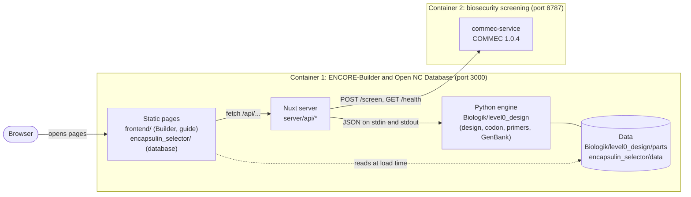

# Architecture

This page shows how the parts of the ENCORE-Builder fit together, so that you can find the
place to change when you want to extend it.

## The parts

| Part | Folder | What it does |
|---|---|---|
| Builder and guide | `frontend/` | The five steps, the guide, the info windows and the 8 translations (`frontend/i18n/`). Plain HTML, CSS and JavaScript. Downloads are GenBank (from the engine) or SBOL 3, which `frontend/sbol.js` converts from the GenBank text in the browser. |
| Open NC Database | `encapsulin_selector/` | Explore the data and Choose a shell. Reads JSON files from `encapsulin_selector/data/`, which are exported from the Excel workbook by `scripts/export-excel-to-json.py`. |
| Server | `server/` | Five endpoints (see [openapi.yaml](openapi.yaml)). It starts the Python engine for every design call and talks to the screening container. |
| Engine | `Biologik/level0_design/` | Builds the Level 0, 1 and 2 constructs. Codon optimization (`user_codons.py`, `codon.py`), PCR primers (`primers.py`, `Biologik/primer_design/`), GenBank export (`genbank_writer.py`), input checks (`sequence.py`). |
| Part data | `Biologik/level0_design/parts/` | One file per toolkit part, backbones and overhangs. |
| Screening | `commec-service/` | Small web service around COMMEC. It downloads its databases on the first start. |
| Tests | `tests/unit/` | Python (pytest) and JavaScript (node) tests. They run on every push (`.github/workflows/tests.yml`). |

## Where to change what

* **A new part** (promoter, linker, marker, cargo): add its file under `Biologik/level0_design/parts/`
  and its entry in `Biologik/level0_design/data.py`. The Builder reads the lists from `/api/libraries`.
* **A new nanocompartment for the database:** copy the template in `encapsulin_selector/data/`, see
  [encapsulin_selector/data/README.md](../encapsulin_selector/data/README.md).
* **A new check or output:** add it in the engine and return it from `design_construct()`
  in `Biologik/level0_design/design.py`. The server passes the result on without changes to the fields.
* **A new language:** add `frontend/i18n/<code>.json` (the keys are the English texts).

## Order of a design call

1. The browser sends the choices to `POST /api/design`.
2. The server starts `python -m Biologik.level0_design.cli design` and gives it the JSON.
3. The engine checks the sequences, optimizes the codons you entered, builds the Level 0 parts and the
   Level 1 and Level 2 constructs and designs the primers.
4. The JSON result goes back to the page, which draws the maps and the order list.

Before step 1 the page sends every sequence you entered to `POST /api/cargo/screen`. The Builder
does not calculate a construct when the screening container is not ready or flags a sequence.

## Speed

[scripts/benchmark_design.py](../scripts/benchmark_design.py) times the calculation of a design in the
engine. Measured on an Apple M3 Pro (Python 3.13, 10 runs per case, median):

| Case | Time |
|---|---|
| The README example (toolkit parts only) | 0.02 s |
| The same construct with an own cargo of 500 amino acids (codon optimization and site check) | 0.29 s |

A whole request to `POST /api/design` of the README example, including the start of the Python
process, takes about 0.1 s. Codon optimization is the part that grows with the length of your own
sequences. Run the script yourself with `python3 scripts/benchmark_design.py`.
